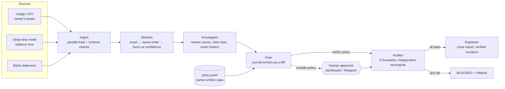

# CloseCrew — Agents on Duty for month-end close

> **Status: reference prototype, not the hackathon submission.** The rules require projects to be built from A to Z
> with Mel. This prototype was written outside Mel to explore the design. The submission is rebuilt from an empty
> folder in Mel using [`mel/SPEC.md`](mel/SPEC.md) and [`mel/BUILD_FROM_SCRATCH.md`](mel/BUILD_FROM_SCRATCH.md).

**Track:** Agentic Banking, Finance & Payments · *the Reconciliation Agent*
**Hackathon:** Global AI Hackathon – Devcon 2026 by Mel ("Agents on Duty")

> Every small business owner loses an evening a month matching their sales spreadsheet against Stripe and the bank.
> CloseCrew hires a crew of six agents to do it: they read the books and the money, name the cause of every
> mismatch, fix the small ones inside a policy the owner wrote, and send everything else to her phone for a
> one-tap decision. An independent Auditor proves the books balance **to the cent** after every action, and
> blocks the close if they don't.

```
difference before:  -RM 94.00   →  16 causes found, 100% of the gap explained
auto-fixed by policy:   8 items  (card fees, 3-sen FX rounding, a RM 12.50 refund)
waiting for a human:    7 items  (duplicate charges, missing sales, a digit-swap typo, a big refund…)
after owner approves:    RM 0.00  ·  Auditor 9/9 checks passed  ·  original ledger untouched
```

## Why it's different

| Most "reconciliation bots" | CloseCrew |
|---|---|
| One agent matches and edits | **Separation of duties**: maker (Fixer), checker (Auditor), explainer, like a real finance team |
| "Looks right" | **Proves it**: Σ exception impacts = the difference, to the cent, before and after every fix |
| Edits your spreadsheet | Never touches the original; every change is a **reviewable diff** (`state/ledger.diff`) |
| Autonomy is all-or-nothing | Autonomy lives in one human-written file, **`policy.yaml`**, hashed on every run |
| LLM decides about money | Money decisions are deterministic; the LLM only writes English, and its text is **rejected if it mentions any amount the Auditor didn't produce** |
| Approve = trust me | Approve → re-run → re-audit → **automatic rollback** if any invariant breaks |

## The crew



| Agent | Decides | Checks its own work by |
|---|---|---|
| **Ingest** | which adapter reads each source (CSV, Stripe API, any wallet export via a column map) | unique ids, valid types, fee ≥ 0, sign consistency; stops the run on bad input |
| **Matcher** | which booking belongs to which payment; payouts ↔ bank lines | every pair carries a reason + confidence; fuzzy pairs require equal amounts; look-alikes go to a human instead of a guess |
| **Investigator** | the cause: fee, duplicate charge, unbooked refund, digit-swap typo, FX rounding, missing sale, unpaid sale, payout in transit… | every exception cites source file + row and carries its exact signed impact |
| **Fixer** | auto-fix vs ask a human (from `policy.yaml`) | writes `ledger_reconciled.csv` + `ledger.diff`; never edits the original; idempotent |
| **Auditor** | whether the close may proceed | recomputes from raw sources; 9 invariants (below) |
| **Explainer** | how to tell the owner | numbers only from the Auditor; LLM text rejected if it invents an amount |

### The Auditor's invariants (all must pass)
1. **Conservation** — every source row is accounted for exactly once (matched, exception, or out of scope)
2. **Every ringgit explained (before)** — processor net − books = Σ exception impacts
3. **Every ringgit explained (after)** — remaining difference = Σ impacts still open
4. **Payouts reconcile to bank** — payouts − bank lines = Σ bank-side exceptions (e.g. in transit)
5. **Payouts equal net of the transactions they settled** — Stripe's own numbers tie out
6. **Auto-fixes within owner policy** — cause allowed, under cap, not blocked, full confidence
7. **No double posting** — unique fix ids, ≤ 1 fix per exception, only for auto/approved items
8. **Integer cents only** — no float drift anywhere
9. **Original ledger untouched** — sha256 before == after

## Quick start (2 minutes)

```bash
pip install -r requirements.txt
python -m closecrew seed        # fake, messy October for a small Malaysian kuih & coffee shop
python -m closecrew run         # the whole crew, end to end
python -m closecrew pending     # what needs a human
python -m closecrew approve EXC-XXXXXXXX --by Shermaine
python -m pytest -q             # 30 tests incl. property-based + red-team
uvicorn app.server:app --reload # dashboard at http://localhost:8000
```

### Deploy a public link
- **Render:** New → Blueprint → this repo (`render.yaml`). Free plan works; no secrets needed.
- **Docker / Railway / Fly:** `Dockerfile` included; listens on `$PORT`.

### Optional integrations
| Env var | What it adds |
|---|---|
| `TELEGRAM_BOT_TOKEN`, `TELEGRAM_CHAT_ID` | Approve/Reject buttons on the owner's phone (`python -m closecrew.telegram_bot`, or auto-started by the server). Only that chat id can approve. |
| `ANTHROPIC_API_KEY` or `OPENAI_API_KEY` (+`OPENAI_BASE_URL`) | Warmer plain-English summary; amounts are verified against the Auditor's numbers |
| `STRIPE_SECRET_KEY=sk_test_…` | `stripe_api` adapter pulls live from Stripe **test mode**; `scripts/seed_stripe.py` creates the test charges. Live keys are refused. |
| `CLOSECREW_ENABLE_STRIPE_ACTIONS=1` | After a human approves a duplicate charge, refund it in Stripe **test mode** |
| `DASHBOARD_TOKEN` | Require `?token=` for approvals on a public deployment |

## Proof it works

- **Ground truth:** `seed` plants every mess and records it in `data/ground_truth.json`. The crew finds **16/16** with **0 false positives** and gets all 4 fuzzy matches right.
- **Property test:** for random months (20–250 charges, random counts of every mess type) the crew finds exactly the planted problems and all invariants hold. Stress-run on 300 random months: **0 failures**.
- **Red-team tests** (`tests/test_red_team.py`): same amount/same day/different customers is *not* a duplicate; a real duplicate is; indistinguishable look-alikes go to a human; an over-rate fee blocks auto-fix; wrong bank amounts aren't force-matched; live Stripe keys refused; malformed files stop the run; a hallucinated amount in LLM text is rejected.
- **Curveball rehearsal:** a TnG eWallet export plugs in through `sources.yaml` with no code change (`test_new_wallet_source_plugs_in_by_config`).

## How Mel is used
The crew is **on duty inside Mel**: Mel's lead agent runs the close, parallel Mel workers independently re-check the
Investigator's evidence, re-derive the Auditor's numbers and draft the owner's message, and **Mel's approval prompt is
the human gate** before every `approve`. Mel was also used to build and harden it: parallel workers per module,
Stripe via MCP (test mode), every edit reviewed as a diff, a red-team pass, and the Sunday curveball.
Prompts: [`mel/MEL_PLAYBOOK.md`](mel/MEL_PLAYBOOK.md).

## Rules compliance
| Hackathon rule | How |
|---|---|
| Runs live on realistic data | Public dashboard on a realistic fake month; "Generate a new random month" lets a tester throw unseen (fake) data at it |
| Checks its own work | Auditor's 9 invariants after every action; 30 automated tests |
| Knows its limits | Ambiguity, low confidence, rate anomalies, anything outside policy → human; failures → BLOCKED + rollback |
| Human approves before money moves | No money ever moves by default; optional Stripe **test-mode** refund only after explicit approval |
| Fake data only, no tax/investment advice | Seeded fake data, Stripe test mode, footer + report disclaimer |

## Repo map
```
closecrew/   ingest · matcher · investigator · fixer · auditor · explainer · pipeline (lead) · telegram_bot · seed
app/         FastAPI server + single-page dashboard
tests/       crew, red-team, policy/adapters, API
mel/         Mel orchestration prompts, MCP config, project brief
docs/        demo script, Devpost write-up, curveball playbook, customer test kit, sample agent work log
policy.yaml  the owner's rules · sources.yaml  where to read from
```
